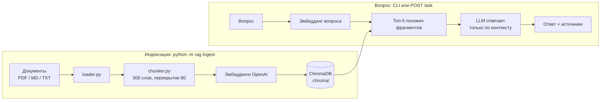

# docs-rag-assistant

RAG-ассистент по вашим документам: загружаете PDF, Markdown или TXT и задаёте вопросы. Ответы строятся только по этим документам и всегда идут со ссылками на источник. Подойдёт как база для бота поддержки, внутренней вики или онбординга.


## Зачем

Обычный чат-бот на LLM отвечает уверенно, даже когда не знает ответа. Для FAQ, регламентов и инструкций это опасно. Здесь модель видит только найденные фрагменты ваших документов. Если ответа в них нет, ассистент так и говорит, а не придумывает. К каждому ответу прикладываются источники: файл и номер фрагмента, чтобы ответ можно было проверить.

## Что умеет

- 📄 Индексирует папку или отдельный файл: `.pdf`, `.md`, `.txt`, включая вложенные папки.
- ✂️ Режет текст на фрагменты по словам с перекрытием, поэтому слово никогда не разрывается посередине, а контекст на стыках сохраняется.
- 🔎 Находит самые похожие фрагменты через эмбеддинги в ChromaDB.
- 🧷 Отвечает строго по найденному контексту и прикладывает источники.
- 🙅 Честно отказывается, если в документах нет ответа (`found: false`).
- 🌐 Отвечает на языке вопроса.
- Работает двумя способами: CLI (`ingest` / `ask`) и HTTP API на FastAPI с документацией Swagger.

Фреймворков для RAG здесь нет. Каждый шаг (нарезка, поиск, «заземление» ответа) написан явно и покрыт тестами.

## Схема



## Стек

- Python 3.10+
- OpenAI SDK: эмбеддинги (`text-embedding-3-small`) и ответы (`gpt-4o-mini`), обе модели настраиваются
- ChromaDB: локальное персистентное векторное хранилище
- pypdf: извлечение текста из PDF
- FastAPI + Uvicorn: HTTP API
- Docker / Docker Compose
- pytest: тесты без API-ключа

## Быстрый старт

```bash
git clone https://github.com/StepanCEO/docs-rag-assistant
cd docs-rag-assistant
pip install -r requirements.txt
cp .env.example .env          # впишите OPENAI_API_KEY

# 1. Проиндексируйте демо-документы из репозитория (или свою папку)
python -m rag ingest sample_docs/

# 2. Задайте вопрос
python -m rag ask "Сколько дней отпуска у сотрудников?"
```

Ответ выглядит примерно так (формулировка зависит от модели):

```
$ python -m rag ask "Сколько дней отпуска у сотрудников?"

Сотрудники получают 28 оплачиваемых дней отпуска в год. Неиспользованные
дни не переносятся на следующий год.

Sources:
  - onboarding.md (chunk 0)
```

В `sample_docs/` лежат два вымышленных документа на английском: гайд по онбордингу и FAQ поддержки. Вопрос при этом можно задать на любом языке, и ассистент ответит на языке вопроса.

Повторный `ingest` пересоздаёт индекс с нуля.

## HTTP API

```bash
uvicorn rag.api:app --reload
```

| Метод | Путь | Что делает |
|-------|------|------------|
| `POST` | `/ask` | `{"question": "..."}` → `{"answer", "found", "sources"}` |
| `GET` | `/health` | проверка, что сервис жив |
| `GET` | `/docs` | интерактивная документация Swagger |

Пример запроса:

```bash
curl -X POST http://localhost:8000/ask \
  -H "Content-Type: application/json" \
  -d '{"question": "Сколько дней отпуска у сотрудников?"}'
```

Формат ответа:

```json
{
  "answer": "...",
  "found": true,
  "sources": [{"file": "onboarding.md", "chunk": 0}]
}
```

Если `OPENAI_API_KEY` не задан, `/ask` вернёт `503` с понятным текстом ошибки.

### Через Docker

```bash
cp .env.example .env                                         # впишите OPENAI_API_KEY
docker compose run --rm api python -m rag ingest sample_docs/  # построить индекс
docker compose up --build                                    # API на http://localhost:8000
```

Индекс хранится в томе `chroma-data`, поэтому переживает перезапуск контейнера. В образ копируется только папка `sample_docs/`. Чтобы проиндексировать свои документы в Docker, положите их туда и пересоберите образ.

## Как работает «заземление»

Модель получает **только** найденные фрагменты и инструкцию: если в контексте нет ответа, вернуть маркер `NO_ANSWER`, не пользоваться внешними знаниями и не угадывать. Приложение превращает этот маркер в честный ответ «В документах нет ответа на этот вопрос.» с `found: false`. Для ответов используется `temperature=0`.

## Настройки (`.env`)

| Переменная | По умолчанию | Описание |
|------------|--------------|----------|
| `OPENAI_API_KEY` | — | обязательно |
| `CHAT_MODEL` | `gpt-4o-mini` | модель для ответов |
| `EMBEDDING_MODEL` | `text-embedding-3-small` | модель эмбеддингов |
| `CHROMA_DIR` | `.chroma` | папка с векторным индексом |
| `CHUNK_SIZE` | `500` | слов во фрагменте |
| `CHUNK_OVERLAP` | `80` | общих слов у соседних фрагментов |
| `TOP_K` | `5` | сколько фрагментов подбирать на вопрос |

## Как устроено

```
rag/
├── __main__.py         # CLI: ingest / ask
├── api.py              # FastAPI: POST /ask, GET /health
├── config.py           # настройки из .env
├── loader.py           # чтение PDF / MD / TXT
├── chunker.py          # нарезка по словам с перекрытием
├── store.py            # обёртка над ChromaDB, эмбеддер подключается снаружи
├── core.py             # поиск → ответ строго по контексту + источники
└── openai_backend.py   # embed / complete через OpenAI
tests/
├── test_chunker.py     # нарезка: размеры, перекрытие, ни одно слово не теряется
└── test_rag.py         # сквозные тесты с фейковым эмбеддером и фейковой LLM
sample_docs/            # демо-документы для старта за минуту
Dockerfile, docker-compose.yml
```

Ядро (`core.py`, `store.py`) не зависит от OpenAI напрямую: функции эмбеддинга и генерации передаются как обычные callable. Поэтому провайдера легко заменить, а тесты запускаются без сети.

## Тесты

```bash
pip install pytest
python -m pytest
```

Тестам не нужен API-ключ. Детерминированный фейковый эмбеддер гоняет настоящий поиск в ChromaDB, а фейковая LLM проверяет логику ответа, отказа и пустого индекса.

## Лицензия

[MIT](LICENSE)

## Автор

**Степан** — fullstack и AI-разработчик
Портфолио: [stepanceo.github.io/Portfolio](https://stepanceo.github.io/Portfolio/) · Telegram: [@SStepCEO](https://t.me/SStepCEO)
